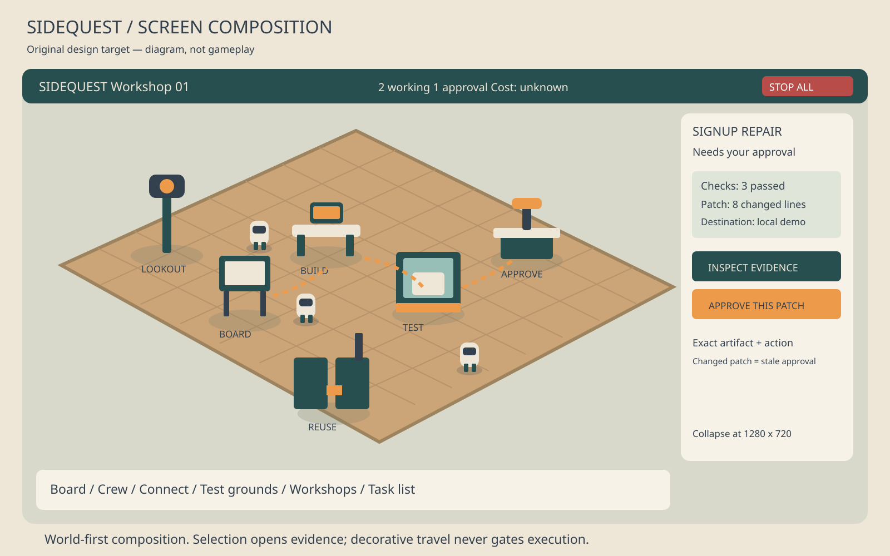

# Sidequest

A Unity automation tycoon. Accept real jobs, assign agents, verify their work, and turn successful procedures into tested workshops.

**Status:** development launch kit, not a working game. The product specification is in [SPEC.md](SPEC.md). No product feature is marked implemented by this setup.

## Start development

Read [START HERE](docs/START_HERE.md). Four independent workstreams are ready:

| Lane | Owns | Goal count |
| --- | --- | --- |
| A — Runtime | Persistent job state, scheduling, policy, HTTP API | 3 |
| B — Tools | GitHub/local Git, coding provider, narrow lookout | 3 |
| C — Unity | Entire Unity project, world, interface, client transport | 3 |
| D — Workshops | Verification, reusable workshop packages, demo acceptance rig | 3 |

Every goal runs as a native Codex persistent goal. A fresh validator thread checks a frozen candidate in another worktree. A rejected candidate returns to its owner. A blocked goal stops its lane. The controller does not treat the builder's completion claim as acceptance.

```bash
python3 -m unittest discover -s dev -p 'test_*.py' -v
python3 dev/loop.py prepare
python3 dev/loop.py run A --allow-network
# Run B, C and D in separate terminals, using the same command shape.
```

The controller is development tooling. It is **not** Sidequest's runtime agent scheduler. It requires local Codex authentication and a Goals-capable app-server. It does not start from a GitHub README automatically. Real model runs and Unity rendering were not executed while preparing this repository.

## Read first

[Parallel ownership](docs/PARALLEL_PLAN.md) · [Frozen interfaces](contracts/PROTOCOL.md) · [Visual brief and image references](docs/ART_DIRECTION.md) · [Research decisions](docs/RESEARCH.md)



## Delivery rule

The complete product must pass the integrated club-signup demonstration with real local processes and a Unity build. Component tests, mock events, documentation, and a successful Git merge do not establish that the game works. The setup has no license grant for third-party assets. Reference screenshots must never enter the shipped game.
