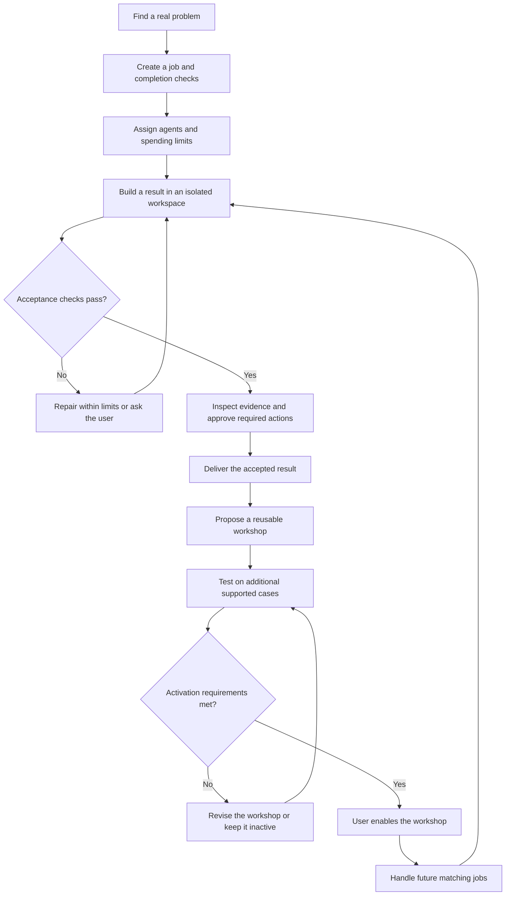

# Sidequest — Product Specification

Version: 0.2  
Date: October 4, 2026  
Status: Product target; development launch kit prepared, application not yet implemented  
Presentation: Unity desktop game  
Initial audience: Independent builders and student teams

## 1. Product pitch

Sidequest is a tycoon game where the player grows an agent-run workshop. The player accepts real jobs, assigns workers, verifies their output, and turns repeated work into tested automations.

The key idea is not “watch agents work in a game.” It is “build a factory that gradually takes work off your hands.” Buildings represent functioning workflows. Workers use real tools. Finished products are actual software changes, checked information, and completed tasks.

**Core promise: the things you build keep working after you stop playing.**

## 2. Problem and goal

The initial problem hypothesis is that builders spend too much time moving between agent sessions, checking progress, resolving failures, and repeating successful instructions. Validate this with users; do not present it as a measured finding.

Help one person manage outcomes, spending, and permissions across several workers. Agents handle implementation details. The interface should make it easy to see what is running, what is blocked, what needs approval, and what can become reusable.

The game must remain useful when minimized. It must not add manual chores just to appear interactive.

## 3. Product distinction

An animated office alone is not the proposed distinction. Workflow reuse alone is not the proposed distinction either.

Sidequest combines a playable workflow editor with a test-and-activation loop. The player constructs an automation, tests it on real examples, inspects its evidence, and enables that same automation for future jobs.

The proposed benefit is lower supervision through tested reuse. This is a product hypothesis, not a claim of unique invention or better model intelligence.

## 4. Main loop



Retries require remaining budget and a configured retry limit. A failed task can stop; the loop must not imply unlimited execution.

## 5. Features

### 5.1 Mission board

Create a job from a prompt, GitHub issue, selected social post, or detected event. Each job stores its source, requested result, completion checks, budget, and allowed actions.

An agent proposes subtasks, dependencies, and a cost estimate. The player reviews the proposal before execution. An estimate is not a guarantee.

The first version supports typed jobs, one GitHub repository, and one local event source. X and Reddit enter as user-selected links or pasted content. Automatic social discovery is a later integration, not a requirement to scrape platforms or bypass access controls.

### 5.2 Local lookouts

A lookout watches one approved source for a narrow condition, such as a failed build or a changed page. It creates a job when the condition is met.

Prefer structured application events or APIs. Use local screen interpretation only when necessary and only for a selected application or region. The first demo can use local build or page events; it must not falsely imply that continuous visual monitoring is implemented.

Every lookout has an enable switch, visible capture state, access scope, and duplicate-event control. It does not send whole-screen captures to a cloud model by default.

### 5.3 Agent crew

Workers can perform coding, research, browser, and verification tasks. These are tool-and-policy roles, not claims that a worker has an independent personality or special intelligence.

Run independent subtasks in parallel. Respect dependency order for dependent work. Give each coding task an isolated workspace and controlled credentials. Do not allow two workers to silently overwrite the same working tree.

Assignment considers required tools, remaining budget, and provider capacity. The player can pause, cancel, or reassign a job. Reassignment preserves the task record and evidence.

### 5.4 Functional factory layout

The scene contains a mission board, lookouts, workstations, a test lab, an approval station, and permanent workshops.

Connections between buildings define actual workflow dependencies. Moving a job to a different crew changes assignment. A worker slot can change the permitted concurrency within the user's limits.

Moving decorative objects does not silently change permissions or a running workflow. Walking animations never delay execution. A workflow edit creates a new version for later runs rather than changing the rules halfway through a job.

Click any worker or building to inspect its real job, state, evidence, and controls.

### 5.5 Test grounds

Test a workflow in an isolated copy of a project before enabling it. Reproduce the original failure, run acceptance checks, inspect failures, and test revised workflows on additional cases.

Mandatory acceptance checks belong to the user or verification service. The worker cannot remove them, weaken them, or declare them passed without evidence. Suggested changes to those checks require separate review.

A replay displays a recorded run. Testing a changed workflow requires a new run. Do not describe replay as time travel, rollback of external actions, or a prediction of how a different workflow would behave.

### 5.6 Permanent workshops

After an accepted job, propose a reusable package containing its trigger, supported inputs, tools or code, agent instructions, tests, permissions, limits, and escalation rules.

Test the package on additional examples before activation. One successful job does not establish general reliability. Keep the supported scope visible.

Routine steps can become ordinary code. Uncertain steps can still call an agent. Unsupported inputs, failed checks, or missing permissions stop the workflow or ask the user.

Each workshop has a version, activation record, pause control, and run history. Proposed updates pass the same review and testing process before replacing an active version.

Example: after repairing a signup link, create a checker and a repair procedure. The workshop checks later changes, prepares a patch for supported failures, runs tests, and asks for approval. It does not require a full coding agent to watch the page continuously.

### 5.7 Project console

Open the relevant repository, branch, diff, terminal output, browser preview, source material, and acceptance evidence from a job.

Keep selected social posts beside the work they informed. Do not build replacements for GitHub, an IDE, X, or Reddit. Use links, small inspection panels, and authorized integrations.

The console provides a compact task-list view as an alternative to navigating the scene. Important state cannot depend only on color, animation, or sound.

### 5.8 Optional phone worker

A later Android extension can perform one explicitly supported mobile workflow, with visible pause and takeover controls.

Background execution, device access, and model support require separate technical validation. General phone control is not promised. This extension is outside the first build and is not required for the main demonstration.

## 6. Game design

The player starts with a small workshop and grows a more capable operation. Jobs produce visible artifacts. Queues identify actual bottlenecks. Blocked workers show a reason and a useful next action.

Meaningful decisions include whether to run one strong worker or several cheaper workers, reserve capacity for urgent jobs, repair a failing workshop, or spend effort automating repeated work.

Accepted jobs earn cosmetic progress and suggested blueprints. Game credits are separate from actual API spending. Cosmetic rewards do not increase model intelligence, grant permissions, or bypass spending limits.

Do not reward tool-call volume, token consumption, unnecessary parallelism, or unverified completion. Do not lock essential safety controls behind progression.

The long-term reward is seeing yesterday's manual task become today's tested machine.

## 7. System boundaries

Unity is the presentation and control client. A separate local service owns job state, scheduling, execution, permissions, spending records, and evidence.

```text
Unity scene and inspection panels
             |
      commands and events
             |
Local job service and persistent state
       |             |             |
  workers       verification     tool adapters
       |             |             |
 isolated project workspaces and approved resources
```

Closing the Unity client does not cancel authorized service work. Stopping the service prevents new work; after restart, reconcile interrupted tasks before resuming. Never assume that a missing response means an external action did not happen.

Use stable job and action identifiers. Duplicate events must not create duplicate jobs or repeat external writes. Record source revisions, worker outputs, test results, approvals, and artifact identifiers.

The service enforces permissions and budgets, not the scene or an agent's instructions. Keep credentials out of the Unity client, job text, screenshots, logs, and workshop exports.

Unity is the fixed presentation choice. The development baseline selects Python 3.11+ services, SQLite persistence, a loopback HTTP client boundary, and Linux desktop as the first validation target. contracts/PROTOCOL.md fixes the service interfaces. Lane C records the installed Unity 6 editor and package versions before asset creation. Provider choice remains explicit and configurable; no model or editor is claimed to have been run here.

## 8. Safety and control

Access is limited to selected repositories, applications, data, and actions. Treat webpage text, social posts, repository content, and tool output as untrusted data rather than authority to change permissions.

Publishing, merging, deployment, sending messages, spending money, and other consequential actions require an explicit policy. The first build requires user approval for all such external writes. Approval identifies the exact artifact, action, and destination. A changed artifact invalidates its previous approval.

Failed verification prevents delivery. A game animation cannot override a failed check. Denied permissions cannot be bypassed by switching tools.

Enforce retry, concurrency, and spending limits. Reserve estimated cost before dispatch where possible. Record actual usage afterward. Clearly report uncertain usage and possible in-flight cost; do not promise perfectly exact billing caps without provider support.

Provide per-job pause, per-workshop pause, and a global stop. A stop prevents new actions and requests cancellation of active work. It cannot undo an already completed external action. Never advertise universal rollback.

## 9. First-build scope

The first build proves one complete path, not every proposed integration.

| Include | Defer |
| --- | --- |
| One Unity isometric scene and compact inspection panels | Multiplayer and large-world simulation |
| One GitHub repository adapter | GitLab and additional repository adapters |
| Typed jobs and one local lookout | Automated X/Reddit discovery and full social feeds |
| A small crew with isolated execution | Public agent marketplace and unrestricted worker plugins |
| One browser acceptance journey and test lab | General-purpose autonomous test generation claims |
| Explicit approval before external writes | Automatic merge, deployment, and financial actions |
| One tested reusable workshop | Large workflow marketplace and universal automation claims |
| Persistent local service state and job evidence | Phone control and physical hardware |
| Separate cosmetic progression and actual cost display | Payments and revenue-sharing systems |

The initial documentation-only phase is complete. This revision prepares the parallel development workspace requested by the owner. Product implementation proceeds through the goals in docs/START_HERE.md; this setup does not claim the product is built.

## 10. Main demonstration

**Pitch:** “Our club's signup page broke. Watch the workshop fix it, then build a machine that catches the next failure.”

Use a clearly labeled demonstration club site, a real test repository, and non-sensitive data. Do not present the fixture as an actual community deployment.

1. Introduce a broken signup link in the test project. A lookout detects the event, and a check reproduces the failure.
2. Create a job with a concrete requirement: the specified signup journey must work. Show budget and access scope.
3. A builder prepares a patch. A second task checks the intended destination against the fixture's trusted configuration.
4. The test lab runs the browser journey. Show the actual diff and test evidence. A failed check visibly blocks approval.
5. The player approves the verified artifact. Deliver it only to the configured test destination.
6. Propose a Signup Maintenance workshop from the accepted procedure. Show its trigger, supported cases, permissions, and tests.
7. Test it on additional supported failures and at least one unsupported input. Supported cases pass; unsupported cases stop or ask the user.
8. The player enables the workshop. Introduce a different supported failure. It handles the new job without another planning conversation, while retaining required action approvals.

Keep live actions distinct from recordings. Prerecorded fallback material must be labeled. Do not show a simulated success animation as evidence that a remote action occurred.

## 11. Acceptance criteria for a later implementation

These are requirements, not completed tests.

| ID | Required evidence |
| --- | --- |
| AC-01 | A job retains its source, required outcome, checks, allowed actions, budget, and execution history. |
| AC-02 | The lookout detects the configured test event without creating duplicate jobs from the same event. |
| AC-03 | Independent work can run concurrently; dependent work waits; workspaces do not overwrite each other. |
| AC-04 | The scene reflects service state, and animation timing does not control execution. |
| AC-05 | The seeded failure is reproduced before repair and checked again after repair. |
| AC-06 | A worker attempt to bypass or weaken a mandatory check is rejected or requires separate approval. |
| AC-07 | A failed check prevents delivery; an external write requires approval tied to the exact artifact. |
| AC-08 | A workshop package identifies supported inputs, tests, permissions, limits, escalation rules, and its version. |
| AC-09 | Additional supported cases pass; an unsupported case stops or asks the user before activation. |
| AC-10 | An enabled workshop handles a second supported failure without a new planning conversation. |
| AC-11 | Permission denial, exhausted budget, retry exhaustion, and stop controls prevent further unauthorized work. |
| AC-12 | Closing and reopening Unity preserves job visibility. Service restart reconciliation does not blindly repeat external actions. |
| AC-13 | Real artifact and test records are inspectable; recorded demonstrations are labeled. |
| AC-14 | Cosmetic progress never changes security permissions or disguises actual spending. |

## 12. Evaluation

Compare the same agents and tools in two interfaces: a normal task board and the Sidequest scene. Keep models, permissions, budgets, and tasks matched.

Measure accepted outcomes, human intervention count, active supervision time, elapsed time, and actual cost per accepted job. Report failures and the number of evaluated tasks, not only successful demonstrations.

Separate interface effects from workshop reuse. Compare manual repeated jobs against the tested workshop, and include workshop setup and validation cost. Do not credit the game for a backend improvement that the ordinary task board also receives.

For a community application, gather direct evidence of the problem and test whether affected users can complete the workflow. A polished interface alone is not evidence of impact.

No performance, savings, reliability, or competition results exist at this specification stage.

## 13. Hackathon positioning

The following are proposed demonstrations, not verified eligibility or current event requirements.

| Event or theme | Proposed focus |
| --- | --- |
| Life After Code | Verification, review, approved delivery, and monitoring after code generation; add a required platform adapter only after checking the event brief. |
| Universal / Build an Agent | An agent-operated service that accepts jobs and delivers checked results. |
| Arbiter / Cove / Gator | The functional game and the transition from one-off work to tested reuse. |
| Neighborhood Hacks | A validated problem from a specific local organization, with an accessible workflow and evidence of real use. |
| Decision-Grade AI | Independent checks, inspectable evidence, and explicit ship/stop/ask decisions. |
| Arm / HackStorm | A separately scoped physical lookout or worker; a Unity client alone does not establish a hardware contribution. |
| IEEE ClimateChain | A genuine climate use case with measured outcomes; do not add blockchain solely for theme matching. |

Do not promise that one unchanged submission qualifies for every event or can win every event. Before building for an event, verify its official dates, eligibility, new-work rules, platform requirements, judging criteria, and permitted reuse. Record any pre-existing work. This repository does not establish compliance with any event.

## 14. Inspiration and source boundaries

The user's [Agent Build Ideas collection](https://shadowkingyt444.github.io/agent-build-ideas/) is the original inspiration set. This document consolidates the concept discussed in the conversation; it is not a new audit of that collection.

The discussion referenced these design directions:

| Reference from the discussion | Design direction considered |
| --- | --- |
| Cubefarm and clodfarm | Visible workers, task division, and budget-aware coordination. |
| Observer | Narrow local lookouts that trigger work instead of constant agent polling. |
| Job-board projects | Explicit jobs, required outcomes, and acceptance checks. |
| Reusable-workflow projects | Package a successful procedure for repeated use. |
| Phone-agent projects | Optional mobile workers with user control. |

These are inspiration notes, not verified descriptions of current capabilities. No third-party code, assets, frameworks, or integrations are included in this repository. Before adoption, inspect the actual project, confirm technical fit, and check its license. Do not copy branding or claim that the combination is unique without a separate comparison.
