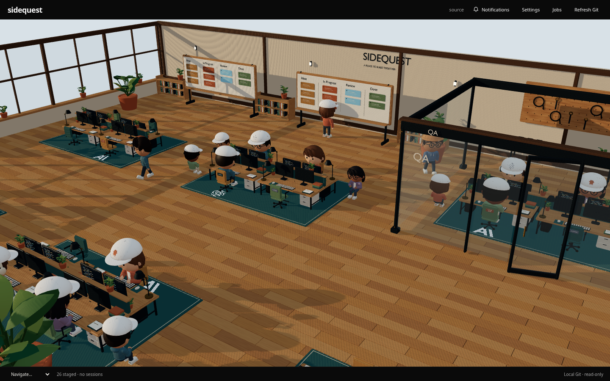
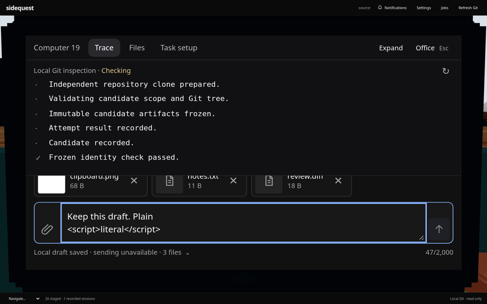
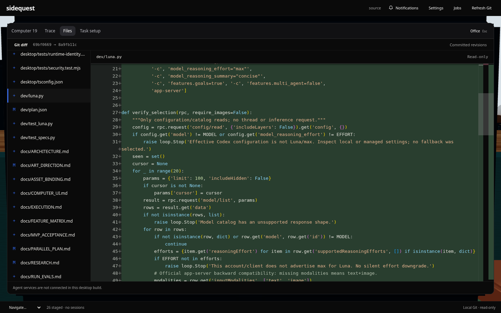
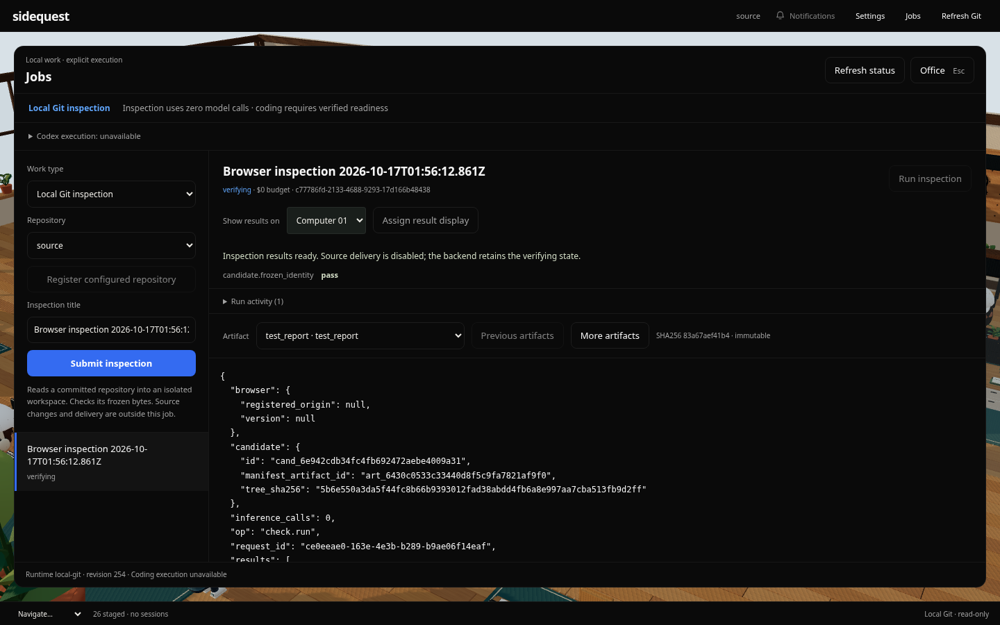

# What works — and the proof

**Browser/local-runtime acceptance passed at the checkpoint below; the whole live coding product is not yet accepted.** The complete browser suite passed **25/25 with zero retries**, no skips or page errors, at functional source `8e39baba943c32da1c09944313e47286c69672ee`. All 252 recorded source/test/asset hashes stayed unchanged. There are also 266 passing local unit/integration tests and a production build. [Full report](../evidence/desktop/startup-browser-20261017/final-full/verification.json) · [CI](https://github.com/ShadowKingYT444/sidequest/actions/runs/38993912999).

“Real browser” means the actual React office, Chromium, Git and local runtime where stated. “Fixture” means an injected response or event; it does not prove a live provider action. A screenshot shows appearance, while the linked checks establish the named behavior.

The separate cloud-desktop tester has also **reported a successful native Electron shell/IPC smoke test** at the same functional source: setup/build and smoke exited 0, Git IPC returned `local-git`, the renderer had no Node access, and the expected isolated bridge/runtime methods were verified with the sandbox intact. This supersedes the earlier blanket native-blocked status. The persistent native office then failed with `WebGL2 blocklisted`; the smoke pass does not establish office rendering. Native Git diff/Expand/Escape/reopen, CLI discovery, zero-model inspection and immutable file viewing passed separately. Codex 0.159.2 initializes successfully there, but reports `Not logged in`. Raw artifacts and seven native UI screenshots are now [imported](../evidence/desktop/native-vm-20261017/README.md); office rendering, OS clipboard/file chooser and live coding remain unaccepted. [Reported result and provenance](../evidence/desktop/native-vm-20261017/README.md).

The graphics-diagnosis repair has 90 passing desktop tests and a passing production build. The independent VM passed both failure/retry browser regressions with Chromium sandbox enabled and unsafe SwiftShader removed, and verified the genuine native graphics error/recovery. The physical office remains blocked by WebGL2 there. The subsequent compact interface passes the independent VM’s five sandbox-enabled browser cases, including 1440/960/390px keyboard and accessibility checks, plus native Jobs/Details, file viewing and draft/trace reload. [Current UI captures and exact source scope](../evidence/desktop/compact-ui-20261017/README.md). The 25-case suite and video below predate these repairs. Jobs file selection survives same-session close/reopen and Expand/Escape; full window reload returns Jobs to its default file. Persistent results, recorded ownership, assignments and drafts are separate. [Exact repair evidence](../evidence/desktop/native-graphics-20261017/README.md).

## Video walkthrough

[Watch the real browser walkthrough (MP4)](../evidence/desktop/proof-20261017/walkthrough-browser.mp4) · [Uncut recording (WebM)](../evidence/desktop/proof-20261017/walkthrough-raw.webm) · [Steps, timing and provenance](../evidence/desktop/proof-20261017/README.md)

The actual launcher and runtime drive a small two-commit Git project. The recording shows office/monitor selection, an unsent local text/file/image draft, Git diff, a real zero-model inspection, its artifact/check/activity and honest unavailable coding/provider usage. It contains no mocked responses or provider turns. It is browser footage on a software GPU; it does not establish native Electron or live coding.

## Capability checklist

| Advertised capability | Verified status | Executable evidence | Visual proof |
| --- | --- | --- | --- |
| Fresh dependency installation and build | **Real setup pass**, including Electron installation; native launch separate | [Fresh setup log](../evidence/desktop/startup-20261017/fresh-setup.log) | [Office reached by actual launcher](../evidence/desktop/startup-20261017/fresh-launch-office.png) |
| One-command runtime + browser start, authenticated readiness and shutdown | **Real pass**; one-commit project, path with spaces, no token files | [Launcher acceptance](../evidence/desktop/startup-20261017/fresh-launch-verification.json), [10 launcher tests](../evidence/desktop/startup-20261017/launcher-final.log) | [Real inspection/file view](../evidence/desktop/startup-20261017/fresh-launch-artifact.png) |
| Original office, figures and workstation navigation | **Real browser pass**; 126 original assets preserved | [Asset preservation](../evidence/desktop/startup-20261017/final-preservation.json), [office tests](../desktop/tests/browser/visual-office.spec.ts) | [Office](../evidence/desktop/startup-browser-20261017/final-full/setup-desktop.png) |
| Click a physical computer and restore the office camera | **Real browser pass**; normal and interrupted return | [Monitor/camera result](../evidence/desktop/startup-browser-20261017/final-full/monitor-camera-browser.json) | [Physical monitor](../evidence/desktop/startup-browser-20261017/final-full/monitor-pov.png) |
| Select a provider at an empty workstation | **Unavailable-state UI passes**; ready-provider execution is not verified | [Guarded picker tests](../desktop/tests/browser/visual-office.spec.ts), [readiness unit tests](../desktop/tests/provider-readiness.test.mjs) | [Honest empty picker](../evidence/desktop/startup-browser-20261017/final-full/provider-selector.png) |
| Installed CLI discovery and connection/usage settings | **Real metadata pass**; installed Codex detected, authentication/reachability/usage remain unknown | [Actual discovery](../evidence/desktop/startup-browser-20261017/final-full/provider-discovery.json), [settings tests](../desktop/tests/browser/visual-office.spec.ts) | [Settings](../evidence/desktop/startup-browser-20261017/final-full/provider-settings.png), [unknown usage](../evidence/desktop/startup-browser-20261017/final-full/provider-settings-analytics.png) |
| Monitor text, file and image drafts; Escape/Expand retention | **Real browser storage/File pass**; synthetic clipboard/drop events are not OS integration | [Retention/attachment result](../evidence/desktop/startup-browser-20261017/final-full/monitor-ui-browser.json) | [Draft with attachment](../evidence/desktop/startup-browser-20261017/final-full/monitor-pov-local-draft.png), [390px](../evidence/desktop/startup-browser-20261017/final-full/monitor-local-draft-390.png) |
| Recorded session ownership on figures, reload and contextual events | **Real local-runtime pass** using zero-model inspection records | [Session result](../evidence/desktop/startup-browser-20261017/final-full/session-browser.json) | [Recorded session](../evidence/desktop/startup-browser-20261017/final-full/recorded-session.png) |
| Workboard/job registration, submission, inspection and result assignment | **Real Git/runtime pass**, zero model calls; source delivery disabled | [Inspection result](../evidence/desktop/startup-browser-20261017/final-full/job-browser.json), [assigned result](../evidence/desktop/startup-browser-20261017/final-full/result-display-browser.json) | [Jobs](../evidence/desktop/startup-browser-20261017/final-full/job-result.png), [assigned computer](../evidence/desktop/startup-browser-20261017/final-full/assigned-result.png) |
| Immutable artifacts, checks and activity | **Real pass**; frozen candidate identity and file reads | [Actual runtime records](../evidence/desktop/startup-browser-20261017/final-full/real-runtime-state.json) | [Check report](../evidence/desktop/startup-browser-20261017/final-full/job-check-report.png), [activity](../evidence/desktop/startup-browser-20261017/final-full/run-activity-actual.png) |
| Git diff/editor, single editor, keyboard, scroll and Expand | **Real Git/browser pass** | [Viewer tests](../desktop/tests/browser/viewer.spec.ts), [editor restoration result](../evidence/desktop/startup-browser-20261017/final-full/monaco-single-reopen.json) | [Diff](../evidence/desktop/startup-browser-20261017/final-full/git-diff.png), [expanded](../evidence/desktop/startup-browser-20261017/final-full/expanded-diff.png) |
| Completion/attention notifications and figure markers | **Labeled fixture pass** using real record IDs; live worker completion not established | [Fixture result](../evidence/desktop/startup-browser-20261017/final-full/notifications-browser.json) | [Explicit fixture screenshot](../evidence/desktop/startup-browser-20261017/final-full/notifications-badges-fixture.png) |
| Send receipt, rejection/reload recovery, no duplicate send | **Five protocol-fake cases pass**, real IndexedDB/File bytes; no real provider send | [Composer tests](../desktop/tests/browser/transport.spec.ts), [mock boundaries](../evidence/desktop/startup-browser-20261017/final-full/mock-real-matrix.json) | [Retained original/new drafts](../evidence/desktop/startup-browser-20261017/final-full/transport/full-run/acknowledged-rejection-restored.png) |
| Narrow layouts and keyboard accessibility | **Automated browser pass** at 390/960/1440px; not a complete manual accessibility audit | [Viewer accessibility](../evidence/desktop/startup-browser-20261017/final-full/accessibility.json), [mobile settings accessibility](../evidence/desktop/startup-browser-20261017/final-full/provider-accessibility-390.json) | [Mobile viewer](../evidence/desktop/startup-browser-20261017/final-full/viewer-390.png), [mobile settings](../evidence/desktop/startup-browser-20261017/final-full/provider-settings-390.png) |
| Literal source text, rejected outside origins/mutations, outage recovery | **Real browser checks with hostile/error response fixtures** | [Viewer tests](../desktop/tests/browser/viewer.spec.ts), [full test results](../evidence/desktop/startup-browser-20261017/final-full/verification.json) | Assertions establish safety behavior; screenshots alone cannot |
| Software-GPU focus and rendering | **Browser pass** at unchanged test timeouts; static/demand rendering preserved | [Before/after diagnosis](../evidence/desktop/startup-browser-20261017/README.md) | Same original office; multi-second SwiftShader stalls remain |
| Native Electron startup/window and isolated Git/runtime IPC | **Separate VM smoke pass reported**: exit 0, real Git IPC, no renderer Node access, sandbox intact. Coding-container sandbox/display failure remains host-specific | [Independent report](../evidence/desktop/native-vm-20261017/README.md), [coding-container probe](../evidence/desktop/startup-20261017/electron-smoke.json) | [Native window](../evidence/desktop/native-vm-20261017/imported/smoke/electron-window.png) |
| Native office rendering and OS clipboard/file chooser | **Office blocked on VM by WebGL2 blocklist**; OS clipboard/file chooser unverified. Git diff/Expand/Escape/reopen, Settings detection and zero-model Jobs/artifact flows passed | [Independent test scope](../evidence/desktop/native-vm-20261017/reported-result.json), [graphics diagnosis repair](../evidence/desktop/native-graphics-20261017/README.md) | [Native graphics failure](../evidence/desktop/native-vm-20261017/imported/screenshots/native-office-blocked.png), [inspection result](../evidence/desktop/native-vm-20261017/imported/screenshots/native-inspection-result.png) |
| Live provider authentication, coding turn, follow-up and delivery | **Blocked / unverified**; VM Codex initialize passes but account is not logged in and approved device sign-in cannot reach the auth endpoint from the desktop. Coding-container EROFS is host-specific; spending/subscription authority still unverified | [Exact Codex blocker](../evidence/desktop/startup-20261017/provider-state-paths.json), [billing review](BILLING_CAPABILITIES.md) | No live-execution proof; mocks are not a substitute |
| Other provider execution and hardware-GPU performance | **Unverified**; non-Codex providers currently have metadata only | [Current limitations](PR1_HANDOFF.md) | No claim or invented demonstration |

## Pictures

These are captures of the real browser office and zero-model Git inspection. They do not show live provider execution.

All 37 final captures are listed in the [verification manifest](../evidence/desktop/startup-browser-20261017/final-full/verification.json). Earlier failures remain in the [evidence index](../evidence/README.md). No tests were relaxed to obtain these results.
