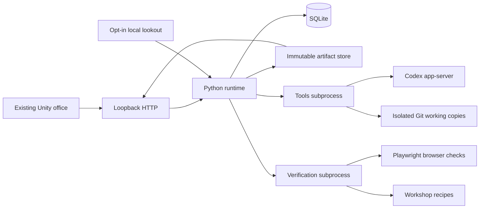
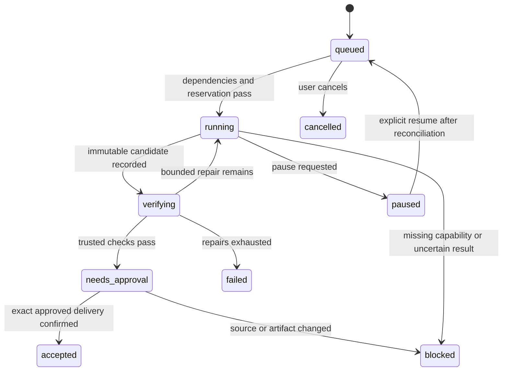

# Fixed architecture — 2026-10-07

Status: implementation target. Read the sections named by your lane. Do not redesign the stack. Sources and alternative tradeoffs are in RESEARCH.md; they need not be reloaded during ordinary development.

## 1. System shape

There is one local application service, not a network microservice cluster. B and D are process-isolated adapters owned by separate development lanes. They return typed records to A; only A writes application state. No database access from Unity, B, or D.

The development goal controller under dev/ is a separate tool used to build Sidequest. It must never be imported by the shipped runtime or confused with the player's worker scheduler.

## 2. Stack and package decisions

| Layer | Fixed implementation | Rejected alternative |
|---|---|---|
| World | Existing Unity project, C#, current compatible render pipeline | Rebuilding art or replacing Unity with a web app |
| UI | uGUI Canvas and TextMeshPro; same view model for world and enlarged computer views | Chromium/WebView and a second React application |
| HTTP | FastAPI + Uvicorn, one process, asynchronous route handlers | Node service plus duplicate Python service |
| Validation | Pydantic 2 for HTTP DTOs; standard json for adapter envelopes | Unchecked dictionaries as public contracts |
| Persistence | Python sqlite3, WAL, foreign keys, single serialized writer | ORM, Redis, PostgreSQL or event-sourcing framework |
| Scheduling | asyncio tasks, semaphore, explicit state transition functions | Model chooses what to run on every tick |
| Workers | Codex app-server JSON-lines bridge; configured model/effort | Reimplementing shell/edit/context loops |
| Git | Installed Git through argv subprocesses | Handwritten diff algorithm or shell command interpolation |
| Browser QA | Playwright Python and Chromium in isolated contexts | LLM walks every regression on every run |
| Capture | Structured event/file source first; Linux portal capture for opted-in screen source | Always-on full desktop screenshots sent to cloud |
| Model watcher | Explicit local multimodal OpenAI-compatible endpoint | Installing unspecified weights or remote fallback |
| Packaging | Linux desktop Unity build plus local Python service launcher and documented setup | Docker orchestration, public SaaS, automatic installer for every OS |

Use Python 3.11 compatibility. Do not force an editor upgrade: the supplied asset project's ProjectVersion.txt and packages-lock.json determine the Unity patch and packages. During preflight, resolve Python package patches once, record exact versions in each lane's requirements lock, and keep them fixed. Package patch selection is an environment-resolution step, not permission to change the architecture. No unverified exact version is claimed by this document.

## 3. Runtime component map — A

Create services/runtime/main.py (entry point), api.py (routes), models.py (DTOs), store.py (SQLite transactions), scheduler.py (dispatch), policy.py (permissions/budget), artifacts.py (authorized reads), adapters.py (subprocess protocol), config.py (local settings), and tests/. Keep units small; do not add a framework inside these files.

Store under $XDG_DATA_HOME/sidequest, or ~/.local/share/sidequest when unset: state.db, artifacts/<sha256>/, runs/<run_id>/ and workspaces/. Keep temporary captures under $XDG_RUNTIME_DIR/sidequest with restrictive permissions. Configuration uses the XDG config directory. API tokens and provider authentication stay outside Git and outside Unity assets.

Tables: projects; jobs; tasks; attempts; workers; events; artifacts; approvals; workshops; watcher_cursors; budget_reservations; command_results; settings. Use explicit SQL migrations numbered in services/runtime/migrations/. IDs are UUID strings except event sequence integers. Money uses integer micro-dollars; UI decimal values are derived, never stored as binary floating-point balances. Unknown cost remains null.

A transaction claims one ready task, reserves capacity/budget and records dispatch intent before spawning. Completion transaction records adapter results, accepted artifact hashes, usage and next state. Notifications are projections of these records, not authority. Command IDs are unique and bind to canonical request hashes. Never replay a consequential action merely because a network response was lost.

## 4. Scheduler, decomposition and integration

Ordinary one-ticket work uses a fixed plan: inspect → build → check → approve → deliver. No model call to construct this plan. A user may enter a bounded plan with at most four tasks and explicit dependencies/write scopes. A natural-language plan request makes at most one bounded planning call; validate its JSON and show it for approval before dispatch. The planner is not a permanent service.

Tasks run concurrently only when dependencies are satisfied, their write scopes are disjoint, capacity is free and budget permits. Missing scopes mean serialize, not guess. A failure blocks dependents. Unrelated tasks continue unless the user stops the project. Default runtime parallelism is two workers; user may explicitly raise it to four. This is distinct from the four development lanes.

Each coding task gets a disposable independent local clone and a pinned base revision. Avoid sharing writable Git refs with other runtime workers. Development lanes still use worktrees because their writers are trusted project developers. Both cases require path checks and a controlled environment; neither constitutes a hostile-code sandbox by itself.

Completed task patches are integrated sequentially into a host-owned integration clone in stable dependency order, then task ID order. Apply and test against the current integration revision. Conflict means blocked integration with a bounded repair request to the original owner, not take-ours/take-theirs. Only the final combined candidate receives delivery approval. A clean merge alone is not acceptance.

Accepted means delivery to the configured local test target or confirmed external target, not merely an agent's final message. A build may be a successful candidate without being an accepted job. A paused in-flight write must be reconciled before restart. Keep action status pending/applied/not_applied/ambiguous independently of display state.

## 5. Adapter protocol and progress

Keep the v1 envelope in contracts/PROTOCOL.md. One request per B/D process. One final response on stdout; diagnostics go to stderr. A supplies a bounded append-only progress file for human-visible run events, per contracts/EXTENSIONS.md. This avoids changing the final response protocol or building WebSocket infrastructure. A tails it, validates records, limits rate/size, and imports safe status events. C polls A; it never opens adapter files.

A assigns request IDs, output roots, cancellation and deadlines. An adapter cannot choose a new artifact root, source repository or delivery destination by returning a path. Resolve all returned paths beneath the assigned roots, reject symlinks, then recompute hashes. No shell=True. Malformed output, unexpected ID, timeout and truncated records have explicit failure paths.

## 6. Freeze and inspect candidates

B collects tracked changes and approved new files, creates a private candidate commit and exports an immutable snapshot. Exclude credentials, ignored build caches and unapproved outside-scope files. Include deletions, modes, renames and binary-file markers in the manifest. Hash the raw patch and the candidate file manifest. D verifies a read-only copy of that same candidate, not a working directory that the builder can still change.

A registers artifacts only after host checks. Every approval binds project, source revision, candidate tree digest, patch digest, action and destination. Content or target changes invalidate it. The computer UI shows the same identity; it cannot approve a stale live preview.

## 7. Shutdown, restart and performance

Closing Unity leaves authorized backend work running. Minimized Unity polls at two seconds instead of 500 ms. A scheduler idle tick is 500 ms and invokes no model. Work completion wakes the scheduler immediately. Concurrency/stop changes are enforced at dispatch, not after an animation.

On service restart, jobs with unfinished attempts are reconciled against saved process/provider identifiers and delivery receipts. Unknown outcomes become blocked/ambiguous. Do not automatically start another chargeable attempt. Use a local delivery marker or remote PR lookup tied to action_id to reconcile writes.

Targets, not measured claims: office 60 fps on the owner's machine; state visible within one second on loopback; text/diff pages under 256 KiB; snapshot under 256 KiB for the supported small-team workload. Page old history rather than growing every poll. Unity pools worker objects and list rows. No AI call for hover, selecting a worker, viewing a file, refreshing a board, animation, budget calculation or deterministic verification.
