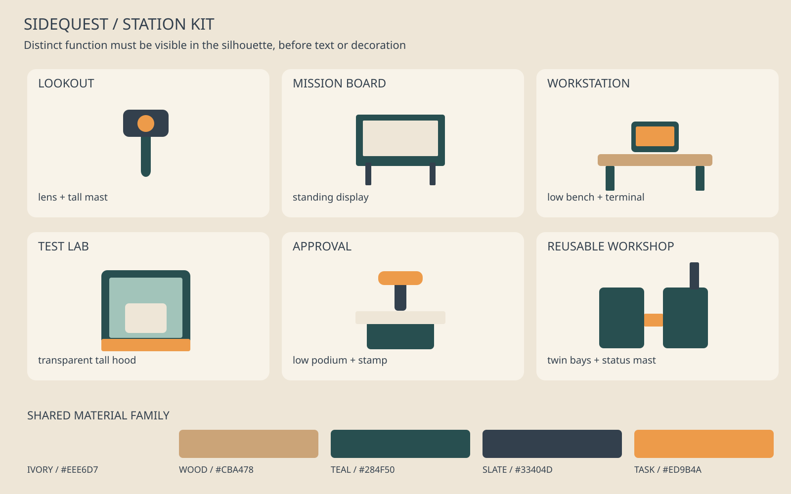

# Art direction — a small workshop, not an AI dashboard

**Binding target:** a warm, readable miniature automation workshop. One orthographic room, six useful station silhouettes, small expressive robot workers, clear object selection and quiet inspection panels. The original SVG boards below are technical design references, not rendered gameplay or evidence that a build exists.

## Real game references — inspect the pixels before C1

These linked screenshots are third-party visual references only. They were located through image search and their official game pages were checked on October 4, 2026. They are **not licensed game assets**. Do not bundle them into the Unity application. Original local boards are committed; the external screenshot bytes are not. Run `python3 dev/cache_references.py` on a network-enabled machine to make local copies for inspection. A failed download must be reported, not silently replaced by an invented reference.

### Good Company — production floor

[Official game page](https://store.steampowered.com/app/911430/Good_Company/). Borrow: Readable machinery, warm rooms, lanes between work areas. Avoid: Do not copy branding, exact assets, dense late-game layout or UI.

### Good Company — placement mode

[Official game page](https://store.steampowered.com/app/911430/Good_Company/). Borrow: Clear selected-object footprint and grid feedback. Avoid: Do not make placement collisions block actual job execution.

### Little Big Workshop — tabletop scale

[Official game page](https://store.steampowered.com/app/574720/Little_Big_Workshop/). Borrow: Toy-like scale, distinct station shapes, shared material family. Avoid: No restaurant props, copyrighted character or texture extraction.

## Spatial rules

Use a 16 by 16 unit floor; 1 unit is a tile. Camera: orthographic, yaw 45 degrees, pitch 35 degrees, no perspective wobble. Start with all stations in frame. Keep a clear path through the middle and at least one tile between stations. Floor edges and modest cutaway walls provide a room, not an infinite plane. Avoid a huge empty lobby.

Main screen at 1920 by 1080: 64 px top status rail, 72 px bottom tool shelf, optional 340 px right inspector. At 1280 by 720: inspector is a collapsible overlay, not a permanently squeezed world. Keep at least 60% of screen area for the workshop when panels are closed. World labels appear on selection or a state change, not above every object forever. All controls must work without navigating the world through the compact task-list view.

Buildings: lookout is a slim mast with a lens; board is a standing two-legged display; workstation is a low L-shaped bench; test lab has a tall transparent hood; approval is a short podium with a large stamp shape; reusable workshop has two linked bays and a small chimney-like status mast. A generic cube with a new label is not a separate silhouette. Crew: rounded small chassis, one dark face panel, two short feet, one role accent. No human-like realism.

## Material and lighting rules

Use five dominant material families: warm ivory `#EEE6D7`, wood `#CBA478`, deep teal `#284F50`, slate `#33404D`, task orange `#ED9B4A`. Status green `#447C5C`, red `#B84C49`, amber `#B27D2A` are sparse accents and always paired with text or icons. Use at least 4.5:1 contrast for normal panel text. These colors are art direction, not mandatory colors for all screenshots.

Low-poly bevels, broad flat surfaces, limited roughness variation. A warm key light from the upper left and soft ambient fill; no full-screen bloom or neon fog. Use contact shadows to attach stations to the floor. Limit noise textures; no random code painted on every monitor. Geometry and layout must carry the design before texture detail.

Panel design: ivory surfaces, slate text, thin teal borders, 8 px spacing increments, restrained 8 px corners. Main body at least 16 px at 1080p, 14 px at 720p; action labels remain readable without zoom. One sans-serif family already available/licensed in the build; do not copy fonts from reference games. Budget shows real cost or “unknown”; cosmetic progress is a separate labeled counter.

## Motion means real state

Idle: slow optional worker glance, no fake typing flood. Running: short movement to the assigned station plus a quiet tool cycle. Verifying: test hood light and actual check count. Needs approval: a stable flag and approval panel action, not continuous bouncing. Blocked: stop animation, show reason and recover/pause action. Accepted: one restrained delivery motion. Snapshot changes drive all states; walking never delays real work.

Hover response under 100 ms is a design target, not a measured result. Selection and panel transitions target 120–180 ms. Reduced-motion mode removes worker travel and repeated cycles but preserves state changes. Escape closes panels, Tab reaches actions, Enter activates, Space is not a hidden irreversible action. Global stop is always visible and text-labeled.

## Required captures and rejection rules

C captures a real Unity scene/build, never a drawing in place of a screenshot. Review at 1920x1080 and 1280x720, both full workshop and inspector open. Capture idle, running, blocked, needs approval and active workshop states. Store small evidence images under `evidence/C/`; larger clips stay outside Git with location and digest recorded. Check these seven items explicitly:

1. All six silhouettes are identifiable without text.
2. Main loop reads left-to-right across stations, with no overlapping connection labels.
3. Text and controls remain readable at both sizes, including the collapse behavior.
4. Every displayed state and count comes from real or visibly labeled fixture data.
5. Lighting, palette and materials match the original boards without copying game assets.
6. Reduced motion, keyboard access and non-color state labels work.
7. No clipped UI, placeholder gray boxes, fake terminals, unlicensed textures or repeated decorative dashboards.

Reject a technically functioning but visually generic result. Also reject a beautiful scene whose controls do not issue real contract commands. Original art and useful interaction are both acceptance conditions.
