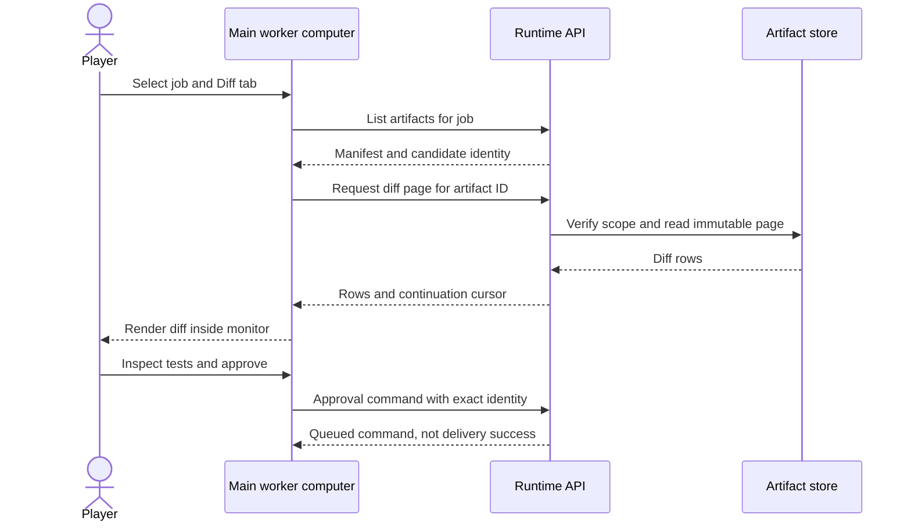

# In-game computer specification

Owner: C for presentation; A for artifact HTTP; B for captured files and diffs; D for check evidence. Required in the first complete release. Opening GitHub externally is not a substitute.

## Interaction

The main worker's desk has a ComputerAnchor with a stable station_id. Click its screen, or select it and press E. The camera moves to the existing FocusPose; office movement input is suspended, not worker execution. Escape returns to the saved camera pose. A visible Expand action gives a readable screen-space version of the same computer. Preserve selected project, job, tab, file, scroll position and candidate hash when moving between modes.

Main computer defaults to the active project and shows all its jobs. A worker computer defaults to that worker's assigned or latest run. The main computer has a worker selector and project selector. Every detail header identifies project, job, worker/run, artifact version and whether the content is LIVE UNVERIFIED or a frozen candidate. Never make a different worker's data appear just because a pooled avatar object was reused.

## Tabs and exact behavior

| Tab | Required behavior |
|---|---|
| Work | Compact job/task list, dependencies, assignment, pause/resume/cancel, blocked reason and next action. No chat transcript by default. |
| Files | Snapshot file list; search filenames locally; open text/Markdown/JSON/CSV as non-executable text; PNG/JPEG as image with zoom/pan. Show unsupported/binary metadata and explicit export action. |
| Diff | File list with additions/deletions/binary/rename status. Unified diff default; line numbers and add/remove/context styles. No model explanation needed. Show the source and candidate revisions. |
| Runs | Redacted user-visible worker messages, tool activity, command output and cost records; paginated. No hidden chain-of-thought. Auto-follow stops when the user scrolls up. |
| Preview | Before/after screenshots and recorded local browser preview frames. Timestamp every frame. Never label a recorded screenshot as live control. |
| Checks | Required checks, pass/fail/blocked, exact evidence, scope and candidate digest. Opens related screenshots/logs without leaving the computer. |

Use a short overflow menu for workshop actions and configuration. On the office overview, show only active count, a quiet notification badge, and Stop. Do not show all these tabs as floating room panels simultaneously.

## Implementation — no browser inside Unity

Use uGUI with TextMeshPro. Attach a World Space Canvas just in front of the existing monitor surface using the supplied anchor's bounds, not guessed asset coordinates. A GraphicRaycaster and the scene's single EventSystem handle input. Use the existing input system; do not install another competing input module. Screen-space enlarged mode uses the same view model and a second view binding with only one interactive view enabled.

Create Sidequest.Client assembly for DTO/HTTP/store classes, Sidequest.Presentation for screen/list/worker controllers, and Sidequest.Editor for binding validation/build tests. Presentation references Client, never the reverse. Do not add dependency-injection or reactive frameworks. A small OfficeBootstrap wires explicit references.

Named components: RuntimeClient, SnapshotStore, OfficeBindings, WorkerPresenter, ComputerController, ComputerViewModel, FileListView, TextArtifactView, DiffView, RunLogView, ImageArtifactView, ApprovalView, CameraFocusController. HTTP and byte decoding occur without blocking the main thread; apply Unity object changes on the main thread. Use UnityWebRequest; disposal and cancellation belong to each view request.

Do not embed Chromium, a real shell terminal, a browser IDE, HTML webviews or arbitrary file:// navigation. Readable plain text and unified diffs cover the first release. HTML output is rendered by the isolated preview service into an image, not executed in the UI. PDF/DOCX/video formats are explicit export-only in this release; do not silently promise native rendering of every format.

## Paging, formatting and safety

Show at most 200 rows per fetched text/diff page; pool at most 100 visible/buffer rows. Maximum page is 256 KiB; a very long line is clipped with a clear indicator and separate text-page inspection. Unknown file encoding or binary bytes produce an explanatory state, not a freeze. Preserve newline markers and escaped unusual filenames. Server generates opaque file IDs; client never sends a filesystem path for arbitrary reads.

TMP richText=false for filenames, source, logs and model messages. Color is applied to row backgrounds and separate status labels, not markup inserted into untrusted content. Strip terminal control sequences in the backend, preserve ordinary text, and never accept OSC clipboard/URL commands. Hyperlinks require a deliberate open action and only http/https after validation.

Allow images up to 4096 pixels per dimension and 16 megapixels decoded; larger originals get bounded preview thumbnails server-side. Compressed size limit is 8 MiB per preview. Reject invalid media, recheck artifact hash, release old textures on selection changes, and cap the image cache at 64 MiB. Set a generation/request ID so a late response cannot overwrite a newly selected file.

Polling: snapshot every 500 ms while visible; one in-flight poll at a time; back off to 1/2/4 seconds on failures. Request details only when open. Logs/preview update no faster than one second. Do not request screenshots when Preview is closed. The view may display cached content offline with a clear disconnected badge, but all mutation/approval controls remain disabled.

## Approval view

User sees changed files, trusted check results, target repository/destination and exact candidate. Buttons: Approve delivery, Reject, Close. Approval remains separate from the later confirmed delivery result. A 409 conflict reloads state and requires a fresh user decision; never automatically approve a replacement artifact. Failed/blocked checks disable approval. Do not hide Stop while focused on the computer.

## Acceptance

C2 tests opening the main computer, switching workers, viewing a multi-file diff with a rename and binary marker, paging logs, image zoom, stale-response suppression, literal hostile markup, and view-mode state preservation. C3 runs in the actual Unity build at 1920x1080 and 1280x720. I1 repeats with real B artifacts and D evidence. A button that merely launches a host browser fails the core file/diff viewing requirement.
