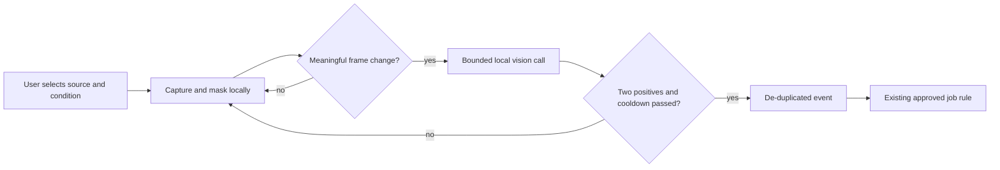

# Execution, monitoring and verification

Fixed implementation target, 2026-10-07. A owns decisions and durable state. B owns external execution and sensing. D owns independent checking and reusable recipes. This is the product runtime, not the development controller.

## 1. Coding workers — B

Create services/tools/main.py, protocol.py, codex_bridge.py, git_ops.py, artifact_capture.py, lookouts.py, capture_portal.py, local_vision.py, config.py and tests/. One request per adapter process, one final JSON response on stdout. Progress uses the host-assigned progress log in the protocol extension. Do not import dev/loop.py into the product.

Use the installed Codex app-server through stdin/stdout. Preserve the account's supported authentication flow; never extract credentials into jobs. On application setup, call model/list and confirm the chosen model and reasoning effort. Preferred values are gpt-6-luna and max. Record the actual effective values. Unsupported selection becomes a visible setup error, not a fallback to Sol. A typed job uses the deterministic pipeline; the worker receives only the task, relevant paths, constraints, completion checks and output location.

Lifecycle: initialize → initialized notification → thread/start in the assigned clone → thread/goal/set with the task objective and token ceiling → turn/start with explicit model and effort → receive normal events until completion or a stop condition. Codex owns its internal editing/tool loop. The wrapper does not keep sending “continue.” Persistent goal support is capability-checked; missing support is blocked. Store provider thread/turn IDs. At completion, independently inspect Git and freeze the candidate. A final assistant message is not proof of a patch or test result.

Use one fresh provider thread per task attempt. A bounded repair receives the previous candidate, deterministic failure summary and relevant evidence; it does not receive every other worker's transcript. Do not expose production credentials, arbitrary MCP accounts, check-authoring paths or delivery tokens to workers. Workspace-write sandbox and restrictive tool settings are mandatory, but local arbitrary code still has residual risk. The first release is for explicitly trusted repositories. Do not advertise safe execution of hostile repositories without a separate OS/container isolation implementation.

Log user-visible agent messages, command/tool status, returned usage and errors. Do not export hidden reasoning, internal prompts, full environment variables or authentication messages. A schema change in an upstream event must not crash the job silently: record an unknown-event diagnostic, continue only when it is not an action/approval request. Unsupported interactive requests stop the task safely. Do not auto-answer a server approval request just to keep the loop running.

Default per-task guardrails: two simultaneous coding workers per account; at most four when explicitly configured; 20 minutes per attempt; 30,000 goal tokens; one repair attempt after a failed candidate. These are initial settings, not guarantees of completion or billing accuracy. Refuse further attempts after exhaustion until the user authorizes more. Respect provider capacity reports and backoff. Never rotate accounts or infer Codex quota from another provider's five-hour-window rules.

## 2. Git and artifacts — B, A

Use subprocess argv with shell disabled. Inspect the registered project path and base revision, reject dirty sources unless the user explicitly registers a separate snapshot. Create an independent disposable clone per task; use --no-hardlinks for local clones. Pin the base SHA and remove unnecessary remote write credentials. B is not allowed to push from a worker clone.

After execution, enumerate changes with Git's machine-readable/NUL-separated formats. Include approved untracked files, deletions, renames, file modes and binary markers. Reject symlinks, special files, traversal paths and files outside the task's write scope. For the supported code workflow, cap a candidate at 1,000 files and 100 MiB; larger changes stop with an actionable explanation. Large art was imported before development and is not regenerated by a repair task.

Create a candidate commit in the isolated clone. Export its checked file manifest, the raw patch, a human-viewable unified diff and text/image artifacts into the host-assigned staging root. Do not calculate a patch from a live directory while QA runs on a different revision. A copies verified bytes into content-addressed storage and records their hashes. D receives the same frozen candidate. A run can expose incomplete live logs, but they are labeled mutable and cannot be approved.

GitHub adapter: read issues/repos through authenticated GitHub CLI or HTTP with existing account permission; B chooses the GitHub CLI for the first release to avoid a second OAuth implementation. Parse JSON output, never terminal prose. Only an explicit host approval may create a PR in the registered test destination. Persist action_id before the call, include it in the PR metadata, and reconcile by lookup on a lost response. No auto-merge, deletion or public posting. Local test delivery follows the same identity and idempotency checks.

## 3. Independent QA — D

Create services/workshops/main.py, checks.py, browser_checks.py, recipes.py, scope.py, reports.py and tests/. Playwright Python is the fixed browser-test engine. A new isolated browser context is created per test run; test credentials and storage do not cross projects. The trusted harness lives outside the candidate. Candidate-supplied scripts cannot replace it or alter the expected signup destination.

Always reproduce the seeded failure before repair. Browser checks exercise navigation and the actual signup outcome, not just HTTP 200. Capture a before image, after image, trace or log, named check results and the candidate digest. Disable browser access to unrelated hosts; use the registered local test origin. A page is untrusted code. Do not put the runtime API token or provider credentials into its browser context.

Default QA has zero model calls: compilation, named unit tests, browser journey assertions, snapshot consistency and required asset bindings. If an unsupported UI behavior needs semantic exploration, the user can request one bounded QA-agent attempt. Use Playwright CLI/skills or a narrow tool interface and save the resulting deterministic check for later runs. Agent opinion never overrides a failed required check. Native Unity behavior is tested with EditMode/PlayMode/build interaction tests, not a web-testing framework.

A baseline cannot be rewritten automatically because a new screenshot differs. Intentional visual changes need a separate review. Capture only the target fixture application. Ignore volatile timestamps when comparing images, but do not ignore the actual controls, error states or diff content.

## 4. Structured lookouts — B

Prefer a registered Git revision/file hash, build process exit, or allowlisted local page condition. Use stable source IDs and persisted cursors. Poll local files at two seconds by default, debounce changes for one second, emit one event per condition transition and persist the cursor. GitHub status polling starts at 60 seconds with backoff; do not poll provider APIs every frame. No model is needed for a process exit code or file change.

An event creates a proposed job from an active user-approved rule. It cannot grant a new permission or approve a write. A de-duplicates by watcher_id and event_id across restarts. While a matching job is running, coalesce later changes into one pending latest revision rather than spawning a job for every save.

## 5. Active screen monitoring — B, opt-in local feature

This is a selected-source watcher, not unrestricted computer control. Implement Linux desktop support via XDG ScreenCast portal → PipeWire → a bounded capture sidecar. Use dbus-next for portal calls and a GStreamer/PyGObject pipeline for frame extraction. Required sequence is CreateSession, SelectSources, Start and OpenPipeWireRemote. Respect the portal's actual selected stream and cancellation. Never bypass the system picker, use a hidden full-desktop fallback, or hard-code PipeWire node IDs. The owner's machine must have the portal backend, PipeWire and GStreamer installed.

Expose capability states available, unavailable and permission_required. A missing capture dependency does not prevent ordinary code jobs, but the screen-watch capability must remain unavailable and cannot pass its own acceptance test. Test and record the chosen Linux desktop environment; macOS, Windows, mobile and cross-platform capture are deferred, not implicitly supported.

After consent, take at most one cropped frame per two seconds, with a 1280-pixel long-edge limit. Apply configured exclusion masks first. Use a deterministic frame-change threshold before local inference: compare a 32-by-32 luminance thumbnail and skip when mean absolute change is below 3/255. Query the selected local multimodal endpoint at most once per ten seconds. Require two consecutive positive observations, emit one rising-edge event, then impose a 60-second cooldown. These thresholds are configuration defaults, not validated detection accuracy.

A watcher configuration has selected_source_id, condition text, masks, interval, local model ID, endpoint reference and an expiration time. Free text is a constrained condition to classify, not executable code. Send one cropped frame and that condition to the local endpoint. Require JSON {matched:boolean,confidence:number,reason:string}; confidence is model-reported, not calibrated. Invalid output or inference failure produces unknown, never true. Do not start another call while one is active. No local endpoint or weights are installed silently. No cloud fallback.

Default retention is no disk screenshots; keep at most two frames in memory. The user may opt in to a redacted evidence image for a fired event. Stop capture when the source closes, permission is revoked, the rule expires, or Stop is pressed. Indicate capture state in both the office and computer settings. Never watch passwords, private messages or unrelated windows by default. Do not let model output invoke arbitrary JavaScript or mouse clicks.

Observer is an upstream reference, not a falsely promised stable SDK. Its repository is AGPL-3.0. This specification adopts the narrow sensor→local model→event pattern through original code. An optional connection to an independently installed Observer instance must be separately version-pinned and capability-tested. It is not a mandatory integration, and a process boundary alone is not a blanket license exemption.

## 6. Tested reusable workshops — D

A recipe is a versioned JSON manifest: id, version, source_job_id, source_candidate_sha256, supported_case_ids, trigger, steps, immutable_check_ids, required_actions, limits, escalation and package_sha256. Steps are allowlisted operations with validated arguments, not arbitrary eval or free-form shell fragments. Model steps, when needed, have explicit objective/template and budgets. A deterministic step must not be converted to an agent call for convenience.

Propose from an accepted job; test the original regression plus two additional supported cases and at least one unsupported case. Unsupported means abstain/ask, not mutate anyway. Hash canonical manifest bytes excluding the hash field itself, and include referenced executable/script hashes. Changes produce a new version and new test record. A stores activation approval and pins the active digest. D never self-activates.

Event matching returns a job proposal. Runtime policy is applied again before dispatch. Reuse removes repeated planning, not test execution or required human approval. Ordinary code steps still consume CPU; zero model calls are not zero compute cost.
