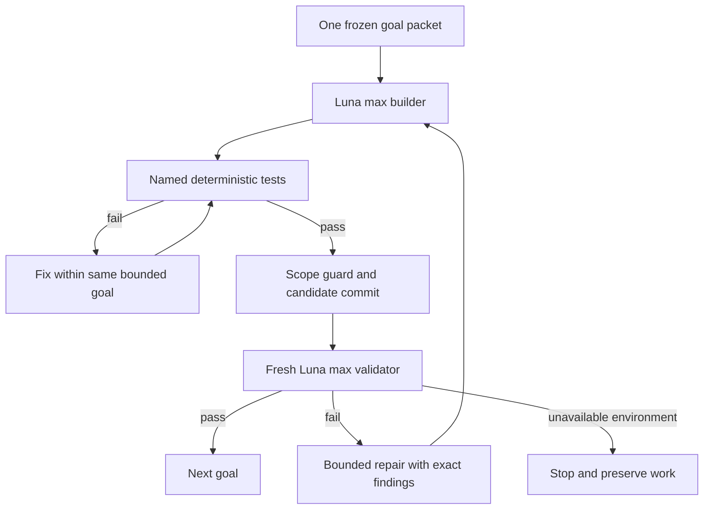

# Low-token development execution

The default is Luna/max workers with a deterministic coordinator. Sol is not an always-running manager. Maximum reasoning is the owner's preference, not a claim that maximum reasoning always uses fewer tokens. Reduce repeated context and unnecessary model invocations first; retain independent verification.

## Fixed model selection

Use gpt-6-luna with model_reasoning_effort=max. The launcher checks effective Codex configuration and the account's model/list response. A model name in Markdown is not proof of access. If the configured model, effort or required modality is unsupported, stop before starting a paid goal. Do not silently substitute Sol, change accounts, or accept a provider upgrade suggestion. The user's external configuration must remain unchanged during a managed run.

`.codex/config.toml` records the preference. Project trust/config layering can prevent it from taking effect; dev/luna.py verifies that instead of assuming the file is active. The check does not start a model turn. Successful preflight is not live execution validation of every app-server method.

## Task packets, not full-repo reading

Each builder gets one goal, its Read list, owned paths, applicable contracts, check IDs and the previous failure summary if any. The three goals per lane remain ordered. Do not load the historical spec, unrelated source READMEs, all journals, or every screenshot at each retry. Read code as needed, with a filename/symbol search before large file dumps. Keep routine handoffs under 250 words; put long logs and screenshots in evidence files.

The architecture and component names are already chosen. Allowed reasoning is about implementation correctness and concrete defects. A worker may propose a specific contract correction when blocked, but it must not run another framework selection exercise. Specs reduce uncertainty; they do not eliminate the need to reason about code and tests.

## Limits

Each of the twelve goals has a 40,000-token builder ceiling and a 12,000-token fresh-validator ceiling. There are at most three builder attempts per goal, including repairs. Each thread also has a 60-minute wall-clock limit. These ceilings use Codex goal accounting, not a guaranteed invoice cap or expected consumption. Billing/quota rules can differ between API and subscription access. B's real-provider smoke tests are additional bounded product calls and must be recorded separately.

A single first pass through twelve builder/validator pairs has 624,000 configured goal-token capacity, plus 12,000 for I1: 636,000 total capacity, not a spending forecast. The previous settings allowed 1,344,000 for the twelve pairs. Limits may still be too low for a difficult goal; stop with evidence rather than reset counters or split it into untracked calls.

The existing controller limits builder attempts but does not impose an aggregate cap on repeated BLOCKED-validator reruns or repeated manual I1 requests. Those are explicit operator actions. Do not run a shell loop that endlessly restarts stopped commands. Inspect the blocker once, fix it, then authorize a retry. Do not describe the controller as an account-wide hard billing firewall.

## Validation order

Run compilation/unit/schema/browser checks before asking another model to inspect a candidate. A reviewer sees the frozen candidate and required evidence, not the builder's chat. Reviewers re-run the relevant checks; they do not reread an entire transcript. No recursive reviewer-of-reviewer tree. One new validator per candidate is enough before the final integrated check.

Run at most four managed development threads concurrently, one per lane. A lane's validator replaces its builder. Product-provider smoke tests can create separate bounded inference, so four development lanes is not a universal limit on all model activity. Running only two lanes at a time is supported and often easier on a laptop running Unity/browser/local vision.

## Escalation

After a repeated specific failure, stop that lane. Prepare a small packet: failing check, exact commit, relevant code, attempts already tried and the unresolved decision. A human may authorize one Sol consultation capped at 12,000 goal tokens to propose a correction. It does not rewrite the entire application, spawn a team, or change protected contracts itself. A coordinator records the accepted correction, then resumes Luna implementation and fresh validation. No automatic escalation is implemented by the launcher.

## Development versus runtime

These budgets govern building Sidequest. The finished application has its own per-job/provider budgets, described in EXECUTION.md. Rendering, sorting, polling, file viewing, deterministic checks and rule matching require no model calls. Runtime planning is a deliberate bounded action, not an expense incurred whenever a worker changes state.
