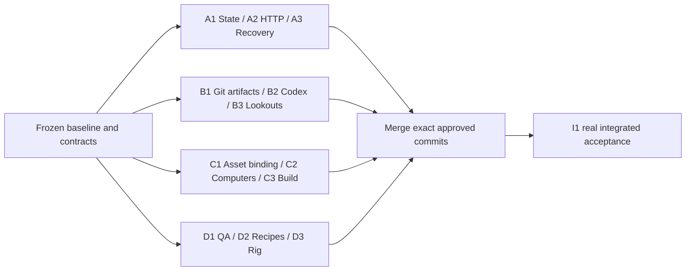

# Parallel implementation: fixed ownership

All four lanes start from one prepared baseline containing these specs and the owner's asset import. Each has three sequential goals. They can implement against frozen fixtures without importing another lane's unfinished code. Integration is deliberately sequential after component completion.

| Lane | Exclusive write paths | Component contract |
|---|---|---|
| A | services/runtime/, journals/A.md, evidence/A/ | HTTP/SQLite/scheduler; fake B/D subprocesses in tests |
| B | services/tools/, journals/B.md, evidence/B/ | Git/Codex/capture adapters; typed input/output fixtures |
| C | unity/, journals/C.md, evidence/C/ | Existing office and native computer; lane-owned HTTP fixture server |
| D | services/workshops/, demo/, tests/e2e/, journals/D.md, evidence/D/ | Trusted QA, recipes and final rig; fake A/B for component tests |

Everything else is read-only during managed development, including contracts, dev/, .codex/, root instructions, goal files and shared reference docs. Each service has a lane-local dependency lock and tests. Only C edits Unity settings, scenes, prefabs and metadata. Completed art is protected by the asset manifest even within C's writable directory.

A uses fake B/D executables, B uses disposable repositories and a fake provider for most tests, C uses the fixture protocol, and D uses frozen candidate fixtures. A real-provider smoke test is required for B2; a real Unity build is required for C3. Test doubles are labeled and cannot establish final product acceptance.

No shared .env, temporary database, browser profile, runtime port or mutable journal. Tests choose ephemeral ports except the default user-facing runtime. Each worker has its own clone/worktree, generated output and context. Source inspection of another lane's committed baseline is permitted; editing its paths is not.

Shared interface defects go to the coordinator as one concrete field/signature/behavior mismatch, with affected goals listed. The coordinator changes the contract once, preserves ongoing work, and schedules revalidation. No lane privately invents another API. A syntactically clean merge does not validate semantics.

Merge A, B, D, then C into sidequest/integration. I1 tests all real components together. The current controller refuses changed approved heads, unvalidated goals and dirty worktrees. If I1 finds a defect, stop, route it to its owner and revalidate the changed goal and integration. Do not repair by resetting branches or taking an entire side of a conflict.
