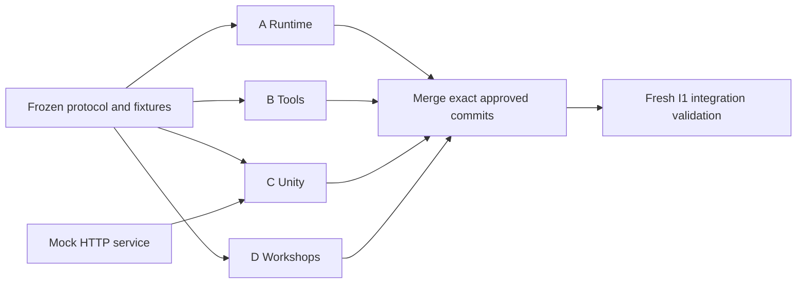

# Four workstreams, one integration gate

The division is by owned subsystem, not by vague roles such as planner, coder, and reviewer. Each lane can finish its three component goals using the frozen protocol and test doubles. No lane needs another lane's unfinished source code to start.

| Lane | Exclusive write paths | Independent input | Deliverable |
| --- | --- | --- | --- |
| A | `services/runtime/`, `journals/A.md`, `evidence/A/` | Contract JSON; fake tool and verifier subprocesses | Local job service and HTTP API |
| B | `services/tools/`, `journals/B.md`, `evidence/B/` | Tool request fixtures; local Git repos; fake provider | Tool subprocess and lookout |
| C | `unity/`, `journals/C.md`, `evidence/C/` | Mock HTTP service; visual reference boards | Playable client and desktop build |
| D | `services/workshops/`, `demo/`, `tests/e2e/`, `journals/D.md`, `evidence/D/` | Artifact fixtures; fake runtime; frozen check IDs | Verifier, reusable package engine, acceptance rig |

`SPEC.md`, `contracts/`, `dev/`, all goal documents, visual boards, root config, and CI are frozen inputs. Dependency manifests are lane-local. A and B never edit Unity. C never implements a second backend. D does not overwrite A's tests. Journals and evidence are lane-local to avoid documentation conflicts.

## Dependency boundaries

A owns process dispatch. B and D implement the specified JSON-line commands. C talks only to HTTP. Neither B nor D imports A's Python internals. Each Python service owns its local dependency file and virtual environment. No shared mutable database outside A. Use assigned ports or ephemeral test ports, unique temp directories, and per-worktree browser profiles.

All ordinary workers operate from the same base commit and do not merge other lanes during component work. Collaborator behavior is represented by fixtures, not guessed functions. An incompatible interface need is a blocker: record the exact requested change and affected lanes. A coordinator updates the contract once and restarts affected validation. Do not let four agents independently redesign the interface.

## Goals and merge order

A1 state/policy → A2 API/scheduler → A3 persistence/recovery.
B1 isolated local tools → B2 live provider/GitHub boundary → B3 narrow watcher/failures.
C1 art/scene → C2 interactive client → C3 build/visual proof.
D1 independent checks → D2 workshop lifecycle → D3 acceptance rig.

These arrows exist only within each lane. The I1 full-product test is intentionally **not parallelizable** with unfinished components. It begins after all lanes pass. Merge A, B, D, then C, and run the real processes together. Merge order does not imply that B waited for A while implementing.

## Why a small controller remains

A strong coding model can choose implementation steps. That does not prevent two writers from changing the same scene, create an independent conversation, or bind a review to a commit. The controller handles only lifecycle, ownership, budgets, frozen candidates, and evidence. It does not enforce a reasoning graph, repeat a coding tutorial, or claim Ralph loops are empirically optimal.

Fresh context is not a proof of independence in the statistical sense. Tests, negative cases, actual screenshots, and a final combined run remain necessary. Keep one Unity writer and no nested agent tree for this build.
